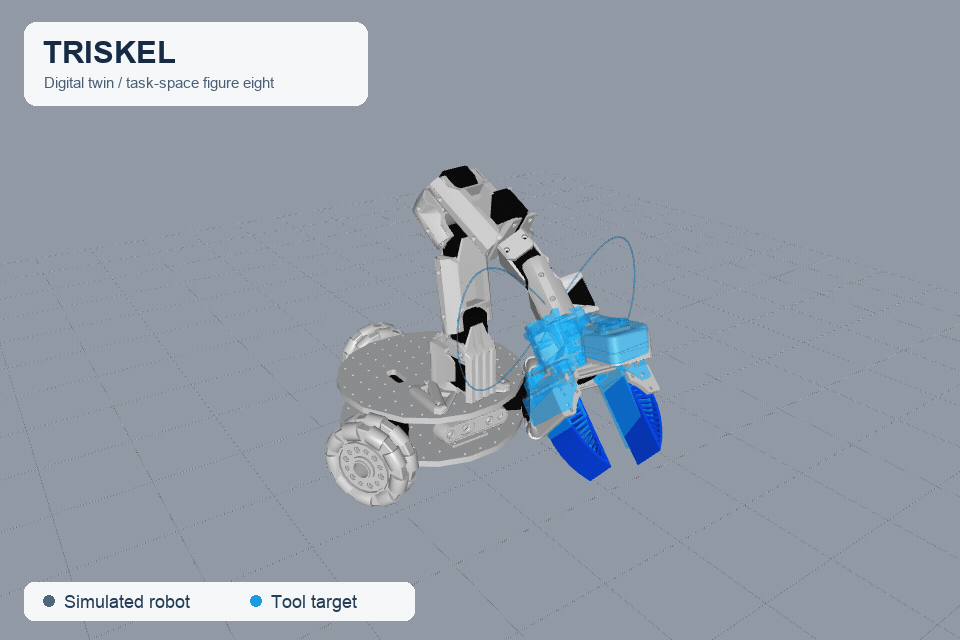

# Humanoid

A Python framework for robot control and teleoperation, built primarily for
**Triskel**, our custom-built mobile manipulator. It also supports **SO-101** in
simulation and on real hardware, and **Panda** in simulation only. The shared
control stack makes it straightforward to add new robots.

See the [documentation](docs/README.md) for setup, usage, architecture, and development.
